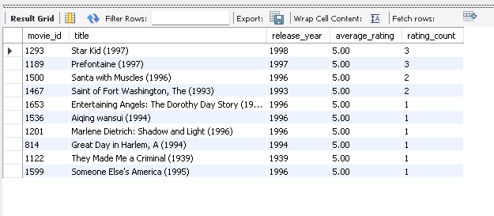
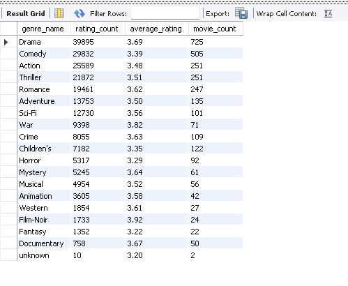

# CineScope: Movie Ratings & User Preference Analysis

## Project Overview

CineScope is a SQL data analytics portfolio project exploring movie ratings and user preferences using the MovieLens 100K dataset.

Using MySQL, I cleaned and structured the dataset into relational tables, validated data quality, and analyzed movie ratings, genre trends, user activity, and rating patterns across demographic groups.

The goal was to turn raw movie-rating data into meaningful insights using SQL.

## Tools & Technologies

- **Database:** MySQL 8.0
- **SQL environment:** MySQL Workbench
- **Dataset:** MovieLens 100K
- **Analysis techniques:** Joins, aggregate functions, subqueries, `CASE` expressions, data validation, and weighted movie-rating rankings


## Dataset

This project uses the **MovieLens 100K dataset**, a collection of movie ratings and related movie and user information.

The dataset used in this analysis contains:

- **100,000** movie ratings
- **943** users
- **1,682** movies
- **19** genres

## Data Preparation & Database Design

I organized the raw data into relational tables in MySQL to make the analysis more consistent and easier to maintain.

The database includes:

- `movies` — movie titles and release years
- `genre` — the list of movie genres
- `movie_genre` — links movies to their genres
- `users` — user identifiers
- `ratings` — user ratings for movies and rating timestamps

I also used staging tables to load and prepare the source files before transferring data into the final tables.

### Data Quality Checks

I used SQL queries to validate the imported data, including:

- Checking row counts and unique identifiers
- Checking for missing or invalid ratings
- Confirming that ratings fell within the expected 1–5 range
- Verifying that ratings referenced existing users and movies
- Verifying that movie–genre relationships referenced existing movies and genres

The final validation checks found **100,000 rating records**, with no missing or out-of-range ratings and no orphaned user, movie, or genre relationships.

## Key Findings

### 1. Highest-Rated Movies

I ranked movies by average user rating while requiring at least 100 ratings per movie to reduce the influence of movies with very few ratings.

Some of the highest-ranked movies were:

| Movie | Average Rating | Number of Ratings |
|---|---:|---:|
| A Close Shave (1995) | 4.49 | 112 |
| Schindler's List (1993) | 4.47 | 298 |
| The Wrong Trousers (1993) | 4.47 | 118 |
| Casablanca (1942) | 4.46 | 243 |
| The Shawshank Redemption (1994) | 4.45 | 283 |

I also calculated weighted ratings using the overall dataset average and a minimum-rating threshold of 100. This approach balances a movie's average score with the amount of rating evidence available.

### 2. Genre Analysis

Drama had the largest number of rating records in the genre analysis, followed by Comedy. Film-Noir had the highest average rating among genres in the overall genre analysis, at approximately 3.92, followed by War at approximately 3.82.

Movies can belong to multiple genres, so genre counts overlap rather than representing mutually exclusive categories.

### 3. User Activity

The most active users submitted hundreds of ratings each. For example, user 405 submitted 737 ratings, while user 655 submitted 685.

This analysis demonstrates how SQL aggregation can identify differences in participation across users. User IDs are used rather than personal identifiers.

### 4. Ratings by Release Decade

The 1930s and 1940s had some of the highest average ratings among the release-decade groups in this dataset, at approximately 3.93 and 4.01, respectively. Movies released in the 1990s accounted for the largest share of ratings because that decade represented most of the movies in the dataset.

These results describe this dataset and should not be interpreted as proof that a movie's release decade causes higher or lower ratings.

### 5. Overall Rating Patterns

The overall average rating was **3.53 out of 5**. I also examined rating patterns by age group and occupation to explore how average scores varied across user groups.s


## SQL Skills Demonstrated

This project demonstrates practical use of SQL for database creation, data preparation, validation, and analysis.

- **Database design:** Creating tables, primary keys, foreign keys, and a many-to-many relationship between movies and genres
- **Data import:** Loading source files into staging tables
- **Data quality:** Checking missing values, duplicate identifiers, invalid ratings, and referential integrity
- **Joins:** Combining ratings, movies, users, and genres
- **Aggregations:** Using `COUNT()`, `AVG()`, `SUM()`, and `GROUP BY`
- **Filtering:** Using `WHERE` and `HAVING` to focus analyses on relevant records
- **Conditional logic:** Using `CASE` to group movies by decade and users by age range
- **Ranking:** Comparing average and weighted movie ratings
- **Analytical interpretation:** Explaining findings while recognizing sample-size limitations and overlapping genres

## Project Structure

```text
CineScope-Portfolio/
├── README.md
├── sql/
│   ├── Business_problem_analysis.sql
│   ├── database_creation.sql
│   ├── movies_table.sql
│   ├── ratingtable-analysis.sql
│   ├── sql_workbench_version.sql
│   ├── table-analysis-&-data.sql
│   ├── tables_creation.sql
│   ├── temp_staging_table.sql
│   └── usertable-analysis.sql
└── images/
    └── (analysis screenshots to be added)
```

## Conclusion

CineScope demonstrates how SQL can be used to transform a raw movie-rating dataset into a structured relational database, validate data quality, and investigate movie ratings, genres, and user activity.

The project combines database design with practical analytical queries and evidence-based interpretation of results.

## Visual Results

### Top-Rated Movies

The query ranks movies by average rating while requiring a minimum of 100 ratings.



### Genre Analysis

This analysis compares rating volume, average ratings, and movie counts across genres.



## Business Insights & Recommendations

Based on the SQL analysis, the following recommendations illustrate how a movie platform could use rating data to inform its decisions.

### 1. Use rating volume alongside average scores

A movie's average rating does not tell the whole story. Combining average scores with rating counts provides context about how much evidence supports a ranking.

**Recommendation:** Display both average rating and number of ratings when presenting popular or highly rated movies.

### 2. Explore genre preferences

Drama and Comedy generated the largest rating volumes in this dataset. Film-Noir and War had relatively high average ratings in the overall genre analysis.

**Recommendation:** Use genre-level analysis as a starting point for exploring content preferences, while checking the number of ratings and movies behind each result.

### 3. Personalize recommendations cautiously

Users differed in their rating activity and average scores. These patterns could be useful for exploring personalized recommendation methods.

**Recommendation:** Test recommendation approaches using users' historical ratings and evaluate their performance before deploying them.

### 4. Interpret demographic patterns carefully

Average ratings varied across age groups and occupations, but these differences alone do not explain why users rated movies differently.

**Recommendation:** Treat demographic patterns as exploratory findings, protect user privacy, and validate any proposed personalization strategy before using it.

### Limitations

- MovieLens 100K is a historical dataset and may not reflect current viewing preferences.
- Ratings indicate user opinions, not objective movie quality.
- Genre totals overlap because movies can belong to multiple genres.
- Differences between groups do not establish cause and effect.
- A SQL analysis of historical ratings is not, by itself, a tested recommendation system.
